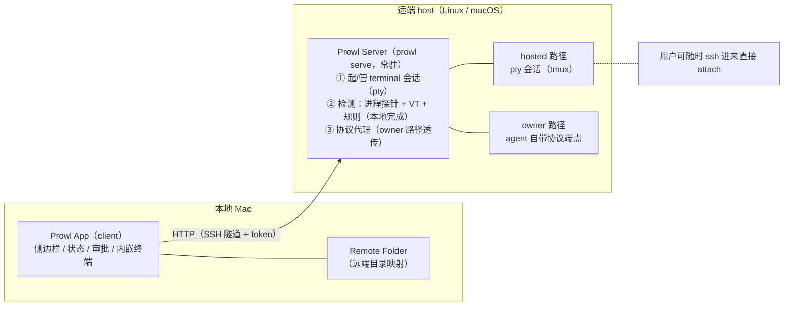
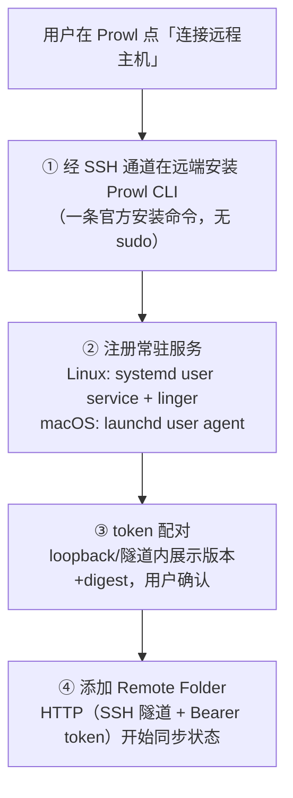

# 082 — Remote Agent Server (SSH 远程支持方案)

> 设计提案(对外版)。日期:2026-10-14。状态:设计目标,依赖实现验收。
> 配套工程规格《PROWL_SSH_SPEC.md》将按本架构另行编写(现有旧版已废弃)。

---

# Prowl 远程支持方案：远端 Prowl Server + 本地 Client

**定位**：对外设计目标说明。**日期**：2026-10-14。**配套**：设计规格（工程版）《PROWL_SSH_SPEC.md》按新架构另行编写（契约、API schema、会话管理、检测、安全与验收以规格为准）；现有同名 SPEC 为旧架构（ephemeral）版本，不构成配套，将整体重写。

> **状态声明**：文中 Prowl Server、HTTP API、server-side 检测与统计 gate 在当前源码中尚不存在，均为设计目标、以实现验收为开放条件；本地对 agent 的协议对话（长期 app-server / ACP client，见 §1）同样不存在、属新增设计目标；对外能力以验收为准。

## 1. 核心架构：检测与管理能力延伸到远端

Prowl 在本地 Mac 管理一组真实终端：起 agent 进程、监听其存在与状态、把 working/blocked/idle 呈现在侧边栏；对 Codex 这类协议 agent，本地观察为文件级（CodexLogProvider 读 daemon.pid、解析 TUI 日志，无长期 app-server / ACP client），屏幕只在本机消化。这依赖两个本地事实——看到 pty 与进程树、读到终端屏幕——SSH 直连皆不可得（归属与屏幕均不可见）。

**答案：在远端 host 运行常驻 Prowl Server，为检测与管理能力的远端本体；本地 Prowl 作为 HTTP client 消费其数据**。Server 职责：

1. **起并管理远端 terminal 会话**：创建真实 pty（可含 tmux 托管）运行指定 agent，终端真实、可随时自行 attach。
2. **检测其管理的 agent 进程与状态**：复刻本地五源证据（进程 / screen / transcript / OSC 7501 / native hook，见 AgentSignal.swift；8 种 runtime 注入 native hooks，OSC verified authority 取得后跳过屏幕读取，OpenCode 另有 sqlite session store），managed tmux / hosted 路径同样注入 hooks + shell 集成（OSC）保持五源同级，hook 注入副作用随设计规格冻结；跑同一套规则产出四态。
3. **协议代理**：agent 自带 app-server / ACP 端点时，server 拉起并绑定、透传协议控制类事件给 client（endpoint 独占见 §2）。本地协议客户端为新增开发；server 复用同一套检测与归属框架（规则包见 §4）。

Server 常驻以用户级服务安装（launchd / systemd user service + linger）为前提，不随任一 SSH / HTTP 连接断开而死；**断线重连即 HTTP 重连，会话状态天然连续**——由此删去一次性 server、租约与断线回收栈（见 §3）。传输：SSH tunnel 冻结为主传输安全模式（`ssh -L` 转发、server 只监听 loopback，细则见 §5），HTTPS/TLS 备选，Tailscale 仅限加密 tailnet 内。会话事件经状态流接口（SSE / WebSocket）推送（详见规格）。

## 2. 产品模型：Remote Folder 不变，宿主变了

Remote Folder 仍是工作对象：**host + SSH 认证 + requested path → canonical path → folder identity**；重连仅在身份一致时继续旧观察，目录被替换、越权即停并报 folder-mismatch / unknown。归属校验由 server 在启动会话与执行控制前执行；运行期持续检测：启动记录 dev/ino，定期与关键操作（重连、控制命令）重验，变化即报 folder-mismatch；canonical path 解析时机与 symlink 处理随设计规格冻结（详见规格）。变化仅在四条路径的宿主：语义平移、宿主迁移，规则不回退。Prowl 是观察者与启动器，非终端看守人：hosted 会话跑在真实 pty / tmux 里，用户随时可 SSH attach，绕过 Prowl 使用不受影响。

### 四条接入路径：会话从哪来，不按能力高低

四条路径语义保留，叙述框架改为「会话从哪来」，切换按对应验收执行。

**owner（agent 自带协议端点）**：server 拉起并绑定 agent 的 app-server / ACP 端点（Codex 用 app-server、OpenCode 用 ACP），依协议事件观察，得协议级状态与事件连续性。「拉起并绑定」契约要点：session 创建、会话身份、事件补洞、生命周期、版本协商随设计规格冻结。endpoint 独占：owner 会话使用 Prowl 自拉起的独立 endpoint，不附着既有 managed daemon；Codex TUI 经 daemon.pid 共享 managed daemon 的归属路径在 managed tmux / hosted 下沿用本地 CodexLogProvider 逻辑——daemon.pid 发现的 daemon 可能承载用户自己的会话，误附着会产生干扰。`turn.completed` 只表示该轮协议事件完成，不是任务完成。

**hosted（Prowl 起的会话；对 Prowl 起的会话为主推路径，对齐 opencode serve / attach 模式；用户已有 tmux 用法走 managed tmux 亦属正常路径）**：server 创建真实 pty 托管 agent 进程，pty 输出流经 SSH 隧道加密推送，client 内嵌终端组件渲染——看屏+打字与本地一致（本地 = Ghostty 渲染 pty，远端 = client 终端组件渲染 pty 流），输入有屏幕回显、无盲输入；agent 跑在真实终端里，随时可 attach 同一会话，Prowl 非独占代理。PTY 流转发协议（raw frame / 序号 / 尺寸 / ACK / backpressure / resize / alternate screen / 断线重放）随设计规格冻结；SSH attach 与 client 同时写同一 pty 的仲裁：tmux 托管天然多路安全，裸 pty 单写者（hosted 由 server 独写）。内核机制边界：macOS 不支持 hosted（见 §4）——那是内核机制缺失，不是体验差异。

**managed tmux（用户 / 工具在 tmux 里跑的会话）**：凭唯一归属的进程、cwd 或 tmux pane 判定，归属唯一、证据完整即可捕获管理，体验同级。tmux 是方案内唯一指定验收的捕获通道（实现验收为准），其余「等价可捕获通道」不承诺；归属证据为进程 + pane id + cwd 组合，多 pane 共享 cwd 时以 pane 归属为准，custom socket / nested tmux / capture 竞态随设计规格冻结。裸 pty 手工会话属非托管会话。

**presence（非托管会话或 server 不可达时）**：只报存在事实；`presence.lost` 需同一完整可见域内两次 fresh complete 且无竞态，不能制造 `session.ended`；视域不完整时报 unknown——管理范围之外的诚实呈现，不判断会话结束。

不变量：`unknown`、`stale`、`inventory-incomplete` 永不改写为 idle、完成或可审批；本地 UI 的 displayState 把 unknown 映射为 idle 只是展示层选择，远端不沿用。未过验收的会话显示 unknown 同属此类。

## 3. 为什么常驻 + HTTP（含关键取舍）

常驻收益四点：①**状态连续**——会话不随断线销毁，断网后 HTTP 重连即恢复观察（对账简化为事件序号补齐；异常路径见 §6）；②**多端接入**——多窗口观察同一份远端事实（只读多窗口即现状承诺；控制仲裁 client ID / lease / takeover / 输入仲裁随设计规格冻结，引用 Remote Mirror per-subscription lease / takeover / ACK 先例）；③**终端真实**；④**架构清晰**（HTTP 是最普通的集成面）。代价（一次性安装 + 常驻进程）可接受：边界压缩到 SSH 用户私有目录、无需 sudo（§5），先例已建立预期。

| 关键取舍 | 内容 |
| --- | --- |
| 常驻 server 换状态连续 | 接受一次性安装 + 常驻进程，换会话不随断线销毁；删一次性 server、租约、framing、HMAC 全栈复杂度。 |
| 检测在 server = 检测特权同级 | server 与 agent 同机，天然拥有本地级检测特权（pty master 端、进程表、tmux capture）；client 只是窗口；managed tmux 因此覆盖手工会话。 |
| HTTP over 受信网络，简化安全栈 | SSH tunnel（主模式）/ HTTPS/TLS + per-device token + 屏幕隐私（不持久化 / 不入日志 / 不遥测 / 仅送达已授权 client），覆盖单用户受信网络威胁模型；明确放弃多用户共享主机。 |
| 标识保留与删除 | 保留 agent process generation、session UUID、server boot epoch（进程重生分辨、会话身份、重启后对账）；删「断线即回收」lease——常驻下无此行为。 |
| 四态语义平移不回退 | unknown 不改写为 idle 的不变量、presence 无 ended 全保留，只换宿主；接入路径是「会话从哪来」的分类，不是能力序列。 |
| macOS hosted 维持不支持 | 没有内核级回收保证就不承诺清场（见 §4）；owner / managed tmux 在 macOS 可用。 |
| 终端真实性优先 | hosted 会话是随时可 attach 的真实终端，不做终端独占代理；Prowl 失效不影响远端现场。 |

## 4. Agent 支持矩阵与平台矩阵

### Agent 支持矩阵（设计目标；上线验收状态以实现验收为准）

| Agent | 本地现状 | 远端接入方式 | 接入路径 | 上线验收状态 | 所需远端 OS |
| --- | --- | --- | --- | --- | --- |
| Codex | 文件级日志（daemon.pid + TUI 日志）+ 屏幕规则 | app-server 协议级增强（较本地文件级更实时） | owner | 首批验收对象 | Linux / macOS |
| OpenCode | 屏幕规则 + native hook + sqlite session store | ACP 协议级增强（server 拉起并绑定） | owner | 首批验收对象 | Linux / macOS |
| Claude Code | 屏幕规则 + native hook + OSC 7501（全活动屏） | 同一套 ClaudeScreenProfile | managed tmux；hosted 备选 | 待验收 | managed tmux 需 tmux（Linux / macOS）；hosted 仅 Linux |
| 其余 14 种检测对象（pi、omp、gemini、cursor-agent、cline、copilot、kimi、droid、devin、amp、qodercli、qwen、grok、antigravity） | 屏幕规则（同本地） | managed tmux / hosted（同一套规则；Devin 另有 acp 子进程探测，与本地一致） | managed tmux / hosted | 逐个过 gate 上线，未上线显示 unknown；hosted 覆盖 17 种可启动 agent（见下） | managed tmux 需 tmux（tmux 为方案内唯一指定验收的捕获通道，见 §2；macOS 同——裸 pty 读不到屏）；hosted 仅 Linux |
| 无协议 agent | 进程存在探测 | 进程存在探测 | presence；可托管为 hosted（创建 pty） | presence 即装即用；hosted 随 Linux 验收 | presence：Linux / macOS；hosted 仅 Linux |

本地已内置 17 种 agent 的进程识别与屏幕规则（`DetectedAgent.swift`）；17 种全部可交互式启动（`AgentProfileRuntime` 17 case 均有 adapter，测试断言 launchableAgents == DetectedAgent.allCases；pi、omp 经 PiRuntimeAdapter / OMPRuntimeAdapter 的 .interactive 形态）。server 复用同一套规则包、切片一致（普通 24 非空行、Pi 32 行、Claude / Antigravity 全活动屏），规则包带签名与版本、独立于 server 升级（详见规格）。

managed tmux 下 Codex 还可用文件级日志观察（TUI 日志在远端 home、server 可读），高于纯屏幕检测。两端覆盖差异：本地 17 种检测天然全覆盖；远端经 hosted / managed tmux，macOS 无 hosted，覆盖窄——是平台边界、非 agent 支持差异。

### 平台矩阵

| 位置 | 平台 | 可用路径 | 边界说明 |
| --- | --- | --- | --- |
| 本地 | macOS | Prowl client（HTTP 消费端） | 完整 |
| 远端 | Linux | owner、hosted、managed tmux、presence | 目标完整形态待 Linux 验收 |
| 远端 | macOS | owner、managed tmux、presence | **hosted 不支持**（见下）；常驻要求 GUI 登录在场，否则为 SSH 会话存续期运行 |

**macOS hosted 边界为何仍成立**：hosted 要求对所创建进程组的强回收保证（终止后不留孤儿）。Linux 以 cgroup v2 + PID namespace 提供「无论 double-fork / setsid 均整体清场」的强回收保证（以实现验收为准）；macOS 无等价机制，逃逸进程只能按 PID 追杀、无法证明清场完整——按「不承诺无法验证的事」，macOS hosted 继续不支持。Codex daemonize 后 owner 清场依赖协议请求退出而非进程组回收，不受此影响。owner 走协议端点无需 containment（endpoint 独占见 §2），managed tmux 只捕获、无需回收保证，二者在 macOS 不受影响。server-side 屏幕检测在 macOS 可用（受限进程 API / `ps` + 屏幕捕获），检测规则与平台无关（详见规格）。

## 5. 安装与安全

### 安装什么、怎么装

安装一次性、长期运行。**远端唯一安装物 = Prowl CLI;server 是其内置子命令(`prowl serve`)**——与 opencode serve、codex app-server 同构,不设独立安装包 / 签名 manifest / 宽限期体系。安装路径四条 = 装 CLI 的三种执行方式 + 不装:

1. **App 内置安装向导（首选）**：自动化执行三步——①经 SSH 通道在远端安装 Prowl CLI（一条官方安装命令，跨平台 linux-amd64 / arm64、macOS；无需 sudo，装到用户目录）②注册 systemd user service + linger（Linux）/ launchd user agent（macOS）③loopback / tunnel 内 token 配对（展示版本、digest、采集范围，用户确认）。全程用户可见可确认，无需 sudo；Linux 注册前需 `loginctl enable-linger <user>`，向导显式处理三种情形：polkit 允许自助开启（自动）/ 需管理员授权（给出精确命令请用户执行）/ 拒绝（降级为「SSH 会话存续期运行」并如实标注非常驻）——未开启 linger 则 user service 随最后一个 SSH 会话退出，linger 检查为向导与验收必过项。macOS LaunchAgent 常驻要求 GUI 登录在场，否则退化为 SSH 会话存续期运行（如实标注）。
2. **手动安装**:远端自行 `brew install prowl` 或官方脚本,然后 `prowl serve`;首连同样走版本 + digest 校验与 token 配对。
3. **管理员预装**:企业 / 专属主机场景（单用户 VM / 独享主机）——管理员预装 Prowl CLI 于固定路径,用户运行 `prowl serve`;只验证路径 + digest,常驻依赖同路径 1 的 linger / launchd 前提。
4. **不安装**：不装也有 presence 路径——client 退化为 SSH 直连存在探测；不为换路径暗中安装任何东西。

默认不改 shell rc、不开放公网端口、不要求 sudo。卸载:停 server、确认会话已结束或由用户接管,卸载 CLI + 删本地信任记录(管理员预装版由管理员移除)。升级 = 升级 CLI(本地远端同一版本号;App 升级后向导提示远端同步);digest 校验对象 = CLI 发行物,信任根同主产品发布渠道,失败回滚为待定目标。

### 安全模型：网络边界 + token

常驻 server 可信、可持续认证，安全模型明显简化：无需再为「每次连接都可能是陌生进程」设计一次性 server、bootstrap framing、HMAC challenge、inode fence 整栈。保留边界：

- **网络层**：server 只监听 loopback / tailnet 接口，经 SSH tunnel（主模式）或 HTTPS/TLS（备选）；Tailscale 仅限 WireGuard 加密 tailnet 内，明文 HTTP 不可接受，**不暴露公网**——同「NAS 不出公网」原则。
- **认证**：一次性 enrollment + per-device token——server 首启生成 device token，client 首连经 loopback / tunnel 配对（展示主机、版本与 digest，确认后写入信任记录）；token 存系统凭据库，此后请求均带 Bearer token；可轮换可撤销——撤销后新连接拒绝、既有连接立即失效；配对契约（bootstrap 认证、一次性、过期、并发竞态、撤销传播）随设计规格冻结，以 Remote Mirror 既有先例为基础（nonce/HMAC、一次性 pairing、5s 期限、撤销）。
- **授权**：per-folder——token 绑定允许操作的 Remote Folder 集合，越权即拒。
- **传输安全**：SSH tunnel 冻结为主模式 + Bearer token，HTTPS/TLS 备选；Tailscale 直连下身份绑定由 enrollment 信任记录承担（host key 指纹 + digest）。
- **屏幕隐私与 payload 分类**：屏幕内容不持久化、不入日志、不遥测，仅经加密隧道送达用户已授权的 client；解析、规则匹配全在 server 本地完成、不依赖屏幕外传。hosted 的 pty 输出流经 SSH 隧道加密推送至 client 内嵌终端渲染，不落盘、不进遥测（tmux / agent 自身的持久化属其自身行为）；命中结果、状态、指纹与必要诊断走 HTTP。协议事件（app-server / ACP 透传）与屏幕正文是两类数据：状态转换、turn 边界、审批请求等**控制类事件**走 HTTP 到 client；事件内嵌正文（prompt、diff、命令输出等）按「最小必要」只在 server 侧解析分类，本体不落盘、不进遥测；owner-control 经安全验收（授权与审计）开放后，client 发送的输入属用户显式动作。透传仅为控制类元数据，数据正文不透传、不入日志（schema 与脱敏详见规格）。
- **凭据最小化**：不同步私钥、home、token、skills、provider 凭据；只访问 folder 授权范围内工作目录。
- **主机身份**：首连展示 host key 指纹、版本与 digest，确认后写入信任记录；host key 变化即阻断。

**威胁模型前提**：单用户、受信网络（Tailscale / tailnet / 隧道），远端为自己的机器或独享 VM；多用户共享主机不在范围内（隔离与防恶意邻居属另一信任模型）；同 UID 进程（含 root）可读取全部受保护数据，属边界之外（细则见规格）。

## 6. 性能与断线行为

| 指标 | 目标 | 常驻语义 |
| --- | --- | --- |
| Server 常驻内存 | RSS ≤ 32 MiB | 空载基线（0 会话），叠加每会话 8 MiB：≈ 32 + 会话数 × 8 MiB，非共享配额 |
| 每会话活动屏增量 | ≤ 8 MiB（活动屏 ≤ 256 KiB） | 会话存续期间持有 |
| 每 Host 并发会话 | 默认 2，硬上限 4 | server 全生命周期计数 |
| 断线会话保持 | **会话不因 client 断开而回收** | 断开只断观察，server 续持 pty 与检测；仅显式关闭或停服时清理 |
| 状态新鲜度 | **与本地同级** | 变更事件推送，网络仅传增量；屏幕快照刷新阈值（2 秒）为 server 新增的快照过期语义（本地 2s 是轮询间隔，非本地平移；超时按 unknown / low confidence） |
| 重连恢复 | HTTP 重连即恢复 | 事件流带序号，补齐断开期间事件（详见规格） |

server 侧异常分四种语义：**主动停止**走清理策略——托管会话按策略终止或交还用户；**进程崩溃**重启后，tmux 托管会话重新发现并归属，裸 pty 随进程消亡如实报 ended；**tmux 持久化**源于 tmux server 独立存续，属 tmux 自身性质、非 Prowl 承诺；**session adoption**按归属规则执行——dev/ino 与会话身份核验通过才重新归属，否则报 unknown / folder-mismatch、不默认认领；资源超限返回 resource-limit。

**常驻生命周期验收契约**（纳入 §7 各阶段，为可验收条件而非描述）：安装（含 linger 检查）→ 升级（在跑会话迁移与回滚标准随规格冻结）→ 重启恢复（tmux 会话重新发现与归属，裸 pty 如实 ended）→ session adoption（重启 / 换 client 后重新归属）→ 资源泄漏（7×24 空载 RSS 漂移与多轮会话创建/关闭后内存 fd 稳定性）→ 多 client 写冲突（仲裁挂账 §7）。

## 7. 阶段路线与验收

每阶段独立验收，前序不过不开启后续；阶段是能力上线节奏，不是体验等级。划分由「按连接生命周期」改为「按 server 能力累积」：

1. **Server 基座**：HTTP 服务、token 认证、健康检查、安装脚本与用户级服务（systemd / launchd）；无检测。
2. **terminal 会话管理**：pty 创建、tmux 集成、自行 attach 验证、会话 CRUD 与资源上限。
3. **检测子系统**：进程探针、server-side VT、屏幕规则包签名与版本化；managed tmux 手工会话检测验收。
4. **协议代理**：Codex app-server、OpenCode ACP 拉起、绑定与事件透传；owner 路径验收。
5. **统计 gate**：每 agent × 版本 × OS ≥ 1,000 真实会话片段，precision 95% Wilson CI 下限 ≥ 95%、recall 下限 ≥ 90%、FPR 上限 ≤ 5%；未达标前该 agent 规则包不上线，blocked / working 以 unknown 呈现，不开放自动控制——这是验收未完成，非能力限制。
6. **owner-control 与输入 gate**：prompt / 审批 / 取消经授权与审计的安全验收后开放；hosted 输入经真实会话 ground truth 验收后开放。

gate 不止规则包：native hook 通道、协议绑定、终端渲染（conformance corpus）、输入安全、session adoption、断线恢复各有独立验收。规则、VT、server 或 adapter 任何变更都触发样本重新冻结与重新评测，分层条件随规格冻结。升级时在跑会话迁移策略挂账为待定项，验收前不承诺。
